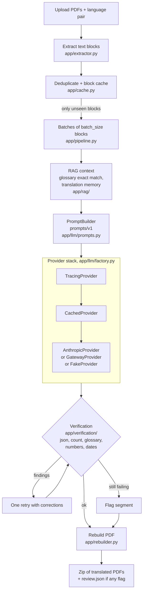

# PDF Translator

Layout-preserving translation of PDF documents by a large language model. A
single-page web UI and a CLI take PDFs in Chinese, Japanese, Korean, English or
French and return PDFs in French or English, with each translated text placed
back where the original was.

## What it does

Extraction, layout and rebuild are deterministic code (PyMuPDF): text blocks
are read with their position, font size and colour, the original text is
erased, and the translation is written back in the same area, shrinking the
font if it is longer. The language model has one job: translating the text
blocks. It never sees or decides anything about layout.

Around that single call the project adds what makes a model usable on
documents where wording matters:

- **Terminology**: a finance glossary (exact match) and an optional translation
  memory (similar validated pairs) are injected into the prompt.
- **Verification**: plain code checks every answer (valid JSON, segment count,
  glossary terms, numbers, dates), retries once with the findings, then flags
  what still fails in a `review.json` instead of delivering it silently.
- **Observability**: versioned prompts, a request cache, and one trace line per
  call (model, tokens, cost, cache hit).
- **Evaluation**: a 30-segment public dataset, three configurations, three
  runs each, compared against a committed baseline.
- **Container**: hardened image, optional password guard, CI.

How one sentence travels through all of this, on a real run:
[docs/how-it-works.md](docs/how-it-works.md).

## Architecture



| Module | Role |
| --- | --- |
| `app/main.py` | FastAPI app: upload, job status, zip download, purge of job files |
| `app/pipeline.py` | One job end to end; also the CLI (`python -m app.pipeline`) |
| `app/extractor.py` | Text blocks with bbox, font, colour; scanned-page detection |
| `app/rebuilder.py` | Redact original blocks, reinsert translations (shrink, then truncate) |
| `app/fonts.py` | Font per script, detection of characters a font would drop |
| `app/translator.py` | `Translator` interface, `MockTranslator`, `get_translator` |
| `app/llm/` | `LLMProvider` protocol, three providers, `LLMTranslator`, `PromptBuilder`, cache and trace wrappers |
| `app/rag/` | Glossary and translation-memory context providers |
| `app/verification/` | Deterministic checks, retry-then-flag policy, `review.json` data |
| `app/cache.py` | Per-block translation cache |
| `app/auth.py` | OAuth2 device flow for the gateway provider |
| `app/access.py` | Optional HTTP Basic guard |
| `app/scanned.py` | Optional multimodal path for scanned pages (off by default) |
| `evaluation/` | Layout and translation suites, committed baseline |

Four providers can be selected with `provider` in `config.yaml` or the
`APP_PROVIDER` environment variable:

| Value | Backend | Needs |
| --- | --- | --- |
| `mock` | `MockTranslator`: deterministic placeholders, no LLM code path | nothing |
| `fake` | `FakeProvider` behind `LLMTranslator`: offline, exercises prompts, cache, tracing, verification | nothing |
| `anthropic` | Anthropic Messages API | `ANTHROPIC_API_KEY` |
| `gateway` | OpenAI-compatible gateway, OAuth2 device flow | the `GATEWAY_*` variables |

### Gateway provider

`provider: gateway` talks to an OpenAI-compatible LLM gateway protected by the
OAuth2 device authorization grant (RFC 8628, `app/auth.py`). The UI shows a
**Sign in** button, a code and a link; the user approves in the browser with
their own SSO session, so the application never handles credentials. Access and
refresh tokens are kept in process memory only, refreshed 60 seconds before
expiry, and never written to disk. The endpoint URLs, client id and scopes come
from the `GATEWAY_*` variables in `.env` (names in `.env.example`). The token
is a module-level variable, so one server process serves one user; a shared
deployment would need per-session storage (see Known limitations).

## Quick start

With Docker:

```bash
cp .env.example .env     # set ANTHROPIC_API_KEY and APP_PASSWORD, and APP_PROVIDER=anthropic
docker compose up --build   # or: make docker-up
# open http://127.0.0.1:8000  (any user name, the APP_PASSWORD as password)
```

`config.yaml` defaults to `provider: mock`, so `APP_PROVIDER=anthropic` in
`.env` is what switches the container to the real model. Compose publishes the
port on `127.0.0.1` only and runs a read-only, capability-dropped container
with a single uvicorn worker (jobs are kept in memory).

Without Docker and without a key (Python 3.11+, tested with 3.12):

```bash
python -m venv .venv && source .venv/bin/activate   # Windows: .venv\Scripts\Activate.ps1
pip install -r requirements.txt
uvicorn app.main:app
```

With `mock` or `fake` no key and no `.env` are needed: you get the full
upload, translate, download cycle with placeholder or scripted translations.
CJK glyphs come from fonts embedded in the `pymupdf` package; nothing is
installed on the machine. Each module also runs from the CLI:

```bash
python -m app.extractor tests/fixtures/simple.pdf
python -m app.pipeline tests/fixtures/simple.pdf --src zh --tgt fr --provider mock
```

## Configuration

`config.yaml` holds non-secret settings; unknown keys or invalid values fail at
load time. Secrets live in `.env` (gitignored).

| Section | Defaults | Meaning |
| --- | --- | --- |
| `provider` | `mock` | `mock`, `fake`, `anthropic`, `gateway` (overridden by `APP_PROVIDER`) |
| `llm` | `model: claude-haiku-4-5-20251001`, `temperature: 0`, `max_tokens: 4096`, `timeout: 60`, `prompt_version: v1` | Pinned call parameters; `compare_models` (evaluation only) and `prices` (cost estimates, USD per million tokens) |
| `rag` | `glossary: true`, `translation_memory: false`, `tm_top_k: 3`, `tm_min_score: 0.3`, `embedder: hashing` | Retrieval context, see below |
| `verification` | `enabled: true`, `max_retries: 1` (0 to 3) | Code checks and retry policy |
| `tracing` | `enabled: true`, `path: traces/llm-calls.jsonl` | One JSON line per LLM call |
| `cache` | `enabled: true`, `path: tmp/llm-cache.json` | Request-level response cache |
| `limits` (top level keys) | `batch_size: 20`, `max_files: 10`, `max_file_mb: 20`, `font_min_scale: 0.6`, `multimodal_enabled: false` | Blocks per call, upload limits, smallest font shrink ratio, scanned-page path |

The gateway provider takes its model from the top-level `model` key, not from
`llm.model`.

**Model choice.** The default is `claude-haiku-4-5-20251001` at temperature 0:
a dated id (the behaviour stays pinned, unlike an alias) that accepts a
temperature. `claude-sonnet-5-5` is listed in `compare_models` for evaluation;
the 5.x models reject sampling parameters, so `temperature` is omitted for ids
starting with `claude-sonnet-5` or `claude-opus-5`. Temperature 0 is still not
bit-for-bit deterministic, hence the request cache and repeated evaluation
runs. See [0012](docs/decisions/0012-claude-haiku-4-5-default-model.md) and
[0003](docs/decisions/0003-temperature-zero-not-deterministic.md).

## Terminology and translation memory

Both live in `app/rag/` and are configured under `rag:`.

- **Glossary**: 59 finance terms in `data/glossary/finance_zh.csv` (columns
  `source,target_fr,target_en,domain`). Terms found in a batch by exact,
  longest-match-first search are injected as required renderings. It applies to
  source `zh` and targets `fr` and `en`. Rationale:
  [0005](docs/decisions/0005-exact-glossary-search.md).
- **Translation memory**: validated zh to en pairs (`data/tm/seed_zh_en.jsonl`)
  similar to the text are injected as examples, ranked by cosine similarity of
  local hashing embeddings (off by default). Rationale:
  [0006](docs/decisions/0006-hashing-embedder-for-translation-memory.md).
  With `rag.embedder: gateway`, segment text is sent to the gateway
  `/embeddings` endpoint whatever the translation provider is.

Provenance of the data files: [data/SOURCES.md](data/SOURCES.md).

## Verification and review

Every answer of an LLM-backed provider (not `mock`) is checked by code in
`app/verification/`, with no second model
([0007](docs/decisions/0007-deterministic-verification-retry-then-flag.md)):

| Check | Fails when |
| --- | --- |
| `json_valid` | the answer is not a JSON object |
| `segment_count` | a segment is missing from the answer |
| `glossary_terms` | a required glossary term is absent (only when terms were injected) |
| `numbers` | a number or currency of the source is not found in the translation |
| `dates` | a date of the source is not found in the translation |

A failing batch is re-sent once with the findings as corrections
(`prompts/v1/retry_corrections.md`). Per segment the best attempt is kept. A
segment that still fails is flagged: it stays in the PDF as translated, is
listed in `review.json` and is never cached. If no attempt is valid JSON, the
batch fails as a job warning and the source text is kept.

`review.json` is written only when something is flagged, next to the output and
inside the downloaded zip: `job_id`, languages, `flagged_count`, and per
segment `segment_id`, `page`, `file`, `source`, `translation`, `failed_checks`,
`messages`. The UI and the CLI report the count. A content-free line per batch
(check names, counters, input ids) goes to `verification.jsonl` next to the
trace file.

## Evaluation

```bash
make eval          # layout + translation suites, offline fake model, vs evaluation/baseline.json
make eval-real     # translation suite with the real model (needs ANTHROPIC_API_KEY)
make eval-report   # publish the translation report to docs/evaluation-report.md
```

The translation suite uses 30 short zh to en extracts from public HKEXnews
announcements ([provenance](docs/decisions/0011-evaluation-dataset-provenance.md)),
three configurations (`no_rag`, `glossary`, `glossary_tm`), three runs each with
the cache disabled. Metrics: glossary adherence, check pass rate, similarity
(`difflib`), chrF, cost, tokens, latency, each as mean and standard deviation
([metrics](docs/decisions/0009-translation-metrics-stdlib.md),
[runs and tolerance](docs/decisions/0010-evaluation-runs-and-tolerance.md)).
`python -m evaluation.run --limit N` runs the first N segments as a smoke test
and is refused together with `--update-baseline`.

With the fake model the numbers measure the pipeline plumbing, not translation
quality: the fake model applies glossary lines literally, so retrieval-augmented
configurations look better than they would with a real model. Only
`make eval-real` says something about quality.

### Results

Full generated report: [docs/evaluation-report.md](docs/evaluation-report.md).

Real models, 30 public zh->en segments, 3 runs per cell (mean; standard
deviations are in the full report), run on 2026-10-05 with `make eval-real`:

| Model | Configuration | Glossary adherence | Check pass rate | chrF | Cost (30 segments) | Mean latency |
| --- | --- | ---: | ---: | ---: | ---: | ---: |
| claude-haiku-4-5-20251001, temperature 0 | no_rag | 0.653 | 1.000 | 65.6 | $0.020 | 1.56 s |
| | glossary | **1.000** | 1.000 | 66.8 | $0.020 | 1.56 s |
| | glossary_tm | **1.000** | 1.000 | 67.2 | $0.028 | 1.74 s |
| claude-sonnet-5-5 | no_rag | 0.674 | 1.000 | 71.7 | $0.047 | 2.07 s |
| | glossary | **1.000** | 1.000 | 72.0 | $0.050 | 2.04 s |
| | glossary_tm | **1.000** | 1.000 | 72.4 | $0.057 | 2.00 s |

What the numbers say:

- The glossary is what moves terminology: adherence goes from about two
  thirds to every required term, for both models, at no measurable cost.
- chrF against the companies' own English versions rises a little with each
  retrieval layer (+1.6 for Haiku, +0.7 for Sonnet from no_rag to
  glossary_tm); for Haiku the translation memory adds about 55% input tokens
  (+37% cost) for the last 0.4 point of that gain.
- Every output passed the code checks (JSON, segment count, numbers, dates)
  and no segment call failed, after structured outputs were added
  ([decision 0013](docs/decisions/0013-structured-outputs-and-fence-fallback.md));
  the first run without them failed 8 of 540 Sonnet calls.
- Sonnet 5.5 is closer to the references (chrF about 72 vs 67) for about 2.5x
  the cost; Haiku 4.5 stays the default because it accepts temperature 0 and
  has a dated id ([decision 0012](docs/decisions/0012-claude-haiku-4-5-default-model.md)).
- Limits: 30 short segments from four issuers, one reference translation per
  segment, and chrF rewards wording close to that reference rather than
  correctness as such.

## Data that persists and privacy

Uploaded and generated PDFs live in per-job directories, are deleted after the
download or when a job fails, and any job older than 30 minutes is purged.
Translated text, however, also goes to local files that outlive the job:

| File | Content | Written when |
| --- | --- | --- |
| `traces/llm-calls.jsonl` | model output plus metadata (input messages are not stored) | `tracing.enabled`, providers other than `mock` |
| `tmp/llm-cache.json` | LLM responses | `cache.enabled`, providers other than `mock` |
| `tmp/cache.json` | per-block translations keyed by hash | every provider |

None has a size cap or expiry. `traces/` and `tmp/*` are gitignored and the
application logger never receives document content
([0004](docs/decisions/0004-traces-are-local-only.md)); do not copy them into
an image or archive. To stop writing them set `tracing.enabled: false` and
`cache.enabled: false` (`tmp/cache.json` has no switch). To delete them, stop
the app and remove the files; with Docker they are in the `tmp` and `traces`
named volumes (`docker compose down -v`). `review.json` follows the job's
lifetime.

With a real provider, segment text is sent to that provider (Anthropic or your
gateway).

## Security

- No secret in the repository: keys and gateway settings are in `.env`
  (gitignored; names in `.env.example`); `make security` scans tracked files.
- `APP_PASSWORD` enables HTTP Basic on every route except `/healthz` (any user
  name). Basic sends the password on each request: put a TLS reverse proxy in
  front for non-local use, use a long random password and rate-limit at the
  proxy (no lockout in the app). Empty means no guard and a startup warning.
- The container runs as a non-root user (checked in CI), read-only, with all
  capabilities dropped. Rationale:
  [0008](docs/decisions/0008-container-and-access-guard.md).
- Logs carry job ids and counters only, never document text or file names.
- Gateway tokens are kept in memory only.

## Development

```bash
make test          # all test modules, hook tests included
make lint          # ruff check + format check        (make format applies)
make eval          # evaluation vs baseline, fake model
make validate      # consistency of .claude/ (agents, skills, hooks)
make security      # secret scan of tracked files
make audit         # pip-audit of requirements.txt (network)
make lock          # regenerate requirements.lock with hashes (uv, Linux, Python 3.12)
make docker-build  # build the image pdf-translator:local
make docker-up     # build and run with compose
make check         # lint + test + validate + security: run before every push
```

Tests never call a real API: `FakeProvider` stands in for the model and every
HTTP exchange is served by `httpx.MockTransport`. Test PDFs are generated by
`tests/make_fixtures.py`, never real contracts. Dependencies beyond
`requirements.txt` need a justification; choices are recorded in
`docs/decisions/`.

CI (`.github/workflows/`):

- `ci.yml` `checks`: lint, `.claude/` validation, secret scan, tests.
- `ci.yml` `eval`: `make eval` with the fake model, reports uploaded as artifact.
- `ci.yml` `docker`: image build, non-root check, smoke test
  (`scripts/docker_smoke.sh`).
- `eval-real.yml`: manual (`workflow_dispatch`) run of `make eval-real` using
  the `ANTHROPIC_API_KEY` repository secret; it spends API credits.

## How this repository is developed

Features are built with Claude Code through a fixed workflow: a planner splits
the request, a human approves the plan, implementers work in parallel git
worktrees, then a reviewer, an evaluator, a security auditor and a docs writer
each check the result and hand over through validated JSON files. Hooks enforce
the rules (no `.env` reads, protected evaluation baseline, secret scan). This
upgrade was itself built that way. Details and lessons learned:
[docs/agentic-development.md](docs/agentic-development.md); the working notes
are in [PLAN.md](PLAN.md).

## Known limitations

- **Layout.** Layout fidelity is approximate. A longer translation shrinks the
  font down to `font_min_scale`, then is truncated with `...`; a block that
  cannot fit at all may be dropped. The extractor can merge adjacent lines (for
  example a date and a disclaimer) into one block. Text colour is the dominant
  colour of a block, not per character.
- **Fonts.** Latin text containing characters outside Latin-1 (such as the
  dagger sign) falls back to a CJK font whose Latin glyphs are monospaced,
  visible as wide letter spacing.
- **Scanned pages.** By default they are copied as is, with a warning cover
  page. With `multimodal_enabled: true` they are sent as images and rebuilt as
  plain reflowed text, which discards the original layout and costs far more
  tokens.
- **Glossary** is Traditional Chinese (Hong Kong usage); Simplified Chinese text
  does not match. The seed translation memory is zh to en only.
- **Hashing embedder** matches shared characters only: no paraphrase and no
  cross-script matching.
- **Verification** does not check numbers spelled out in words or Chinese
  numeral amounts outside dates; cache entries written before verification
  existed are served unchecked.
- **Single-user gateway token**: all users of one server process would share
  the last token stored. Per-session storage is not implemented.
- **Fake-model evaluation** measures plumbing, not quality.
- **Temperature 0 is not deterministic**; see the cache and multi-run design
  above.

## License

[MIT](LICENSE).
