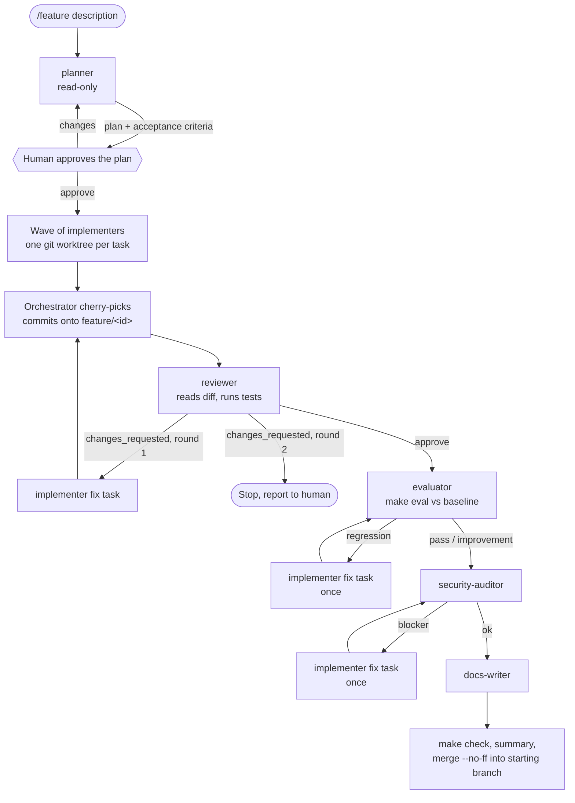

# Agentic development

This repository is developed with Claude Code through a fixed workflow: a
feature request is planned, implemented in parallel git worktrees, reviewed,
evaluated, audited and documented by specialised agents that hand work to
each other through validated JSON files. Hooks enforce the rules that must
not depend on an agent remembering them.

Everything described here is versioned under `.claude/` and checked in CI by
`scripts/validate_agentic_config.py`.

## Layout

```text
CLAUDE.md                      project memory loaded by every session
.claude/
  settings.json                permissions + hook wiring (versioned)
  settings.local.json          personal overrides (gitignored)
  agents/*.md                  the six workflow agents
  skills/<name>/SKILL.md       /feature, /eval, /release-check + 3 procedures
  hooks/*.py                   hook scripts (Python, tested in tests/test_hooks.py)
  schemas/handoff.schema.json  JSON Schema exported from hooks/handoff.py
  handoffs/                    run-time handoff files (gitignored)
  worktrees/                   implementer worktrees (gitignored, managed by Claude Code)
  forbidden-terms.local.txt    local list of names that must never be committed (gitignored)
```

## Workflow



The main Claude Code session plays the orchestrator by following
`.claude/skills/feature/SKILL.md`. It never writes feature code; it spawns
agents, reads their handoffs, integrates commits and decides the next step.
The only human checkpoint is after the plan; every later gate is mechanical
(tests, evaluation, audit) and stops the run when it fails.

Implementers branch from the feature branch's HEAD (`worktree.baseRef:
"head"` in settings.json), commit on their worktree branch, and the
orchestrator cherry-picks those commits in plan order. The final merge into
the starting branch is `--no-ff` with a message listing the tasks, review
verdict, evaluation verdict and audit result, so each feature leaves its
trace in history. Nothing is pushed.

## Agents

| Agent | Role | Tools | Model | Why this model |
| --- | --- | --- | --- | --- |
| `planner` | Splits a request into independent tasks with acceptance criteria | Read, Grep, Glob, Bash (git read-only), Write (handoff only) | opus | Decomposition errors propagate to every later step; the most capable model is worth it for one call per feature |
| `implementer` | Implements one task with its tests in its own worktree, commits | Read, Edit, Write, Grep, Glob, Bash | sonnet | Runs once per task, often in parallel; strong at code at a fraction of the cost, and the reviewer catches what it misses |
| `reviewer` | Checks the diff against criteria and checklist, runs tests, gives a verdict | Read, Grep, Glob, Bash (tests, lint, git read-only), Write (handoff only) | opus | The quality gate: missing a defect costs more than the review |
| `evaluator` | Runs `make eval`, compares with the baseline, reports regressions | Read, Grep, Glob, Bash (`make eval`, git read-only), Write (handoff only) | haiku | Mechanical: run a command, copy numbers, apply a fixed protocol |
| `security-auditor` | Secrets, sensitive data, employer references, dependencies, privacy | Read, Grep, Glob, Bash (scanners, git read-only), Write (handoff only) | opus | A leak is irreversible once pushed; judgment beyond pattern matching is needed |
| `docs-writer` | README, decision notes, how-it-works, diagrams | Read, Grep, Glob, Edit, Write (Markdown and docs/ only) | sonnet | Clear technical prose from a known diff; no deep reasoning needed |

"Read-only" agents still need to write their handoff, so they keep the Write
tool, but `guard_role.py` restricts their writes to `.claude/handoffs/` and
their Bash to a per-role allowlist of command prefixes. The hook is wired in
`settings.json`, not in the agents' frontmatter, and reads the role from the
`agent_type` field Claude Code adds to tool events inside a subagent: Claude
Code skips frontmatter hooks of project agents until the workspace trust
dialog has been accepted, which never happens in a headless `claude -p` run.
The first demonstration run exposed this (a planner ran `sed` unchecked), and
`make validate` now rejects hooks declared in agent frontmatter.

## Hooks

| Event | Matcher | Script | Effect |
| --- | --- | --- | --- |
| SessionStart | startup, resume, clear, compact | `session_context.py` | Adds branch, dirty files, plan progress, latest handoff, last eval verdict to the context |
| PreToolUse | Bash, PowerShell | `guard_bash.py` | Blocks `rm -rf`, force pushes, `git reset --hard` on main, `git clean -f`, any `.env` read, shell writes to eval references, `make eval-baseline` |
| PreToolUse | Bash, PowerShell | `secret_scan.py` | On `git commit`: scans the added lines for secrets and local forbidden terms; blocks on a hit |
| PreToolUse | Edit, Write, MultiEdit, NotebookEdit | `guard_write.py` | Blocks writes to `.env*` (except `.env.example`) and edits of existing eval references |
| PreToolUse | Read, Grep | `guard_read.py` | Blocks reading `.env*` (except `.env.example`) |
| PreToolUse | Bash, PowerShell, Write, Edit, MultiEdit, NotebookEdit | `guard_role.py` | Inside a subagent (`agent_type`): keeps read-only roles read-only and docs-writer on Markdown; no effect elsewhere |
| PostToolUse | Edit, Write, MultiEdit | `lint_python.py` (via `run_hook.py`) | `ruff format` + `ruff check --fix` on the written `.py` file; unfixable issues go back to the agent (exit 2) |
| SubagentStart | the six agents | `record_subagent_start.py` | Records the agent's start time |
| SubagentStop | the six agents | `validate_handoff.py` (via `run_hook.py`) | Requires a handoff written since start and valid against the schema; otherwise exit 2 and the agent keeps working |
| PreToolUse | SubagentHandback | `validate_handoff.py` (via `run_hook.py`) | Same check when a background agent hands its report back, so an invalid handoff cannot be delivered |

`run_hook.py` runs a hook with the main checkout's venv interpreter (pydantic,
ruff), also when the agent works in a worktree. The other hooks use the
standard library only.

The evaluation references are protected twice: `guard_write.py` refuses to
modify an existing file under `evaluation/dataset/` or
`evaluation/baseline*.json`, and `guard_bash.py` refuses shell commands that
write there. A new reference file can be created (that is how a dataset is
first added). A human who wants to change a reference launches Claude Code
with `AGENTIC_ALLOW_REFERENCE_EDIT=1`; an agent cannot set that variable for
the hook process.

The same secret scan runs for commits made by hand once
`make hooks-install` has installed the git pre-commit hook.

## Handoff protocol

Every agent's last action is to write `.claude/handoffs/<task_id>.<agent>.json`
in its working checkout (its worktree for an implementer; the orchestrator
copies those into the main checkout). The model is
`.claude/hooks/handoff.py` (Pydantic); the exported JSON Schema is
`.claude/schemas/handoff.schema.json`.

| Field | Type | Notes |
| --- | --- | --- |
| `task_id` | string, `^[a-z0-9][a-z0-9-]{1,63}$` | Must match the file name prefix |
| `agent` | enum of the six agents | Must match the file name suffix |
| `status` | `done` \| `blocked` \| `needs_review` | |
| `summary` | string, 10-4000 chars | |
| `files_changed` | list of paths | |
| `tests` | `{command, passed, failed}` or null | Required from implementer and reviewer; an implementer cannot be `done` with failures |
| `decisions` | list of strings | |
| `risks` | list of strings | Reviewer prefixes required changes with `REQUIRED:`, auditor uses `BLOCKER:`/`MAJOR:`/`MINOR:` |
| `next_agent` | agent name, `human` or `none` | |
| `tasks` | list of `{id, title, description, acceptance_criteria, files_hint, depends_on}` | Planner only, required when `done` |
| `verdict` | `approve` \| `changes_requested` | Reviewer only, required |
| `metrics` | map of metric to number | Evaluator only, required |

Validation happens in the SubagentStop hook: the agent cannot finish until
the file exists, is newer than the agent's start, and validates. After four
refusals the hook releases the agent with a warning so a confused agent
cannot loop; the orchestrator then treats the task as blocked.

## What the first run taught

The `/feature` demonstration (adding `--version` to the CLIs, merge commit
`4f72661`) ran the whole chain in headless sessions and exposed six problems,
all fixed in the configuration described above:

| Observed | Cause | Fix |
| --- | --- | --- |
| The planner ran `sed` although its role forbids it | Claude Code skips frontmatter hooks of project agents until the workspace trust dialog is accepted; `claude -p` never accepts it | Role guard wired in `settings.json`, role read from `agent_type`; the validator rejects frontmatter hooks |
| The run stopped after integrating the first task | In `claude -p` the process exits when the orchestrator ends its turn, killing the background test run | `/feature` requires foreground commands and test groups under the 10-minute tool limit |
| An off-schema evaluator handoff was delivered, then rewritten by the orchestrator | Background agents finish through the SubagentHandback tool; blocking only SubagentStop came too late | Same validation on PreToolUse `SubagentHandback`; the orchestrator sends errors back and never writes another agent's handoff |
| Reviewer and auditor refused `git grep`, `make security`, a quoted grep pattern | Allowlist too narrow; the command splitter cut inside quotes | Allowlist extended; quote-aware splitting and redirect detection |
| Implementers refused by the worktree isolation check | `git add && git commit` chains and heredocs are too complex to verify | Implementer told to issue one git command per call and write files with tools |
| Two hook tests failed under load | One Python process per test case; on a saturated machine some exceeded their timeout | Guards tested in-process, one real subprocess run per guard kept |

The security auditor also raised a real issue in the feature itself (the
`setuptools>=61` build floor admitted vulnerable versions), fixed afterwards.

## Usage

```text
/feature add a --version option to the CLI   # full workflow, stops after the plan
approve                                       # continue after reviewing the plan
/eval                                         # evaluation vs baseline
/release-check                                # GO / NO-GO before pushing
```

Non-interactive (the plan checkpoint becomes a second invocation):

```bash
claude -p "/feature add a --version option" --permission-mode auto --output-format json
claude -p "approve" --resume <session_id> --permission-mode auto
```

Maintenance:

```bash
make validate                          # after editing anything under .claude/
python .claude/hooks/handoff.py --export   # after changing the handoff model
python .claude/hooks/handoff.py .claude/handoffs/*.json   # validate handoffs by hand
make hooks-install                     # git pre-commit secret scan for manual commits
```

## Limitations

- Hooks are guard rails, not a sandbox: a deliberately obfuscated shell
  command can evade pattern checks. Permission deny rules are a second layer;
  review remains the real control.
- The forbidden-terms list is local by design, so CI only checks generic
  secret patterns. Each contributor keeps their own list.
- `guard_role.py` allowlists command prefixes; it does not inspect what an
  allowed command does (e.g. a test that writes files).
- In docs-writer "check mode" (`/release-check`) the agent is told not to
  edit; the role guard still allows Markdown writes.
- On Windows each hook costs one Python process start per tool call; on
  slow machines this adds seconds per call.
